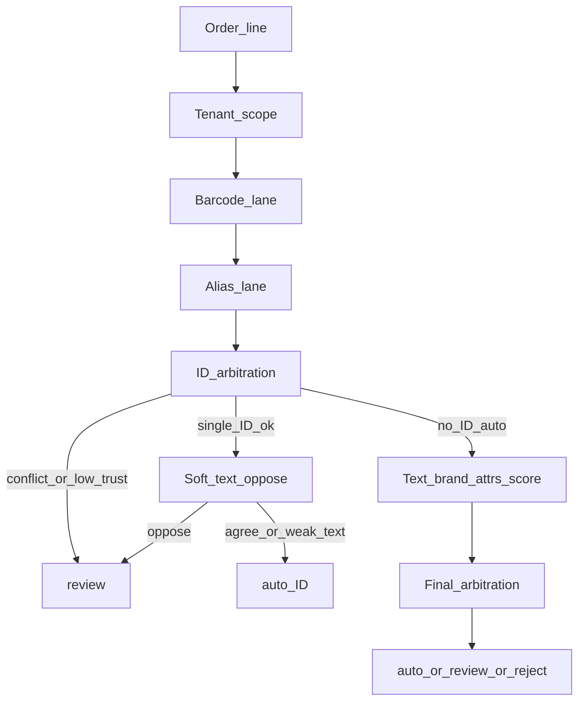

# DESIGN.md — Problem framing and matcher design

## 1. Objective function

This is not an accuracy problem. It is **precision at a chosen coverage** under asymmetric costs.


| Outcome                | Relative cost (from brief)        |
| ---------------------- | --------------------------------- |
| Correct `auto`         | save ~20s (value **+20**)         |
| Abstain → human review | cost ~40s (**−40**)               |
| Wrong `auto`           | ~**20×** an abstention (**−800**) |


**What we maximise.** Expected net value per line for the policy that emits `auto` / `review` / `reject`:

$$
\mathbb{E}[V] = P(\mathrm{auto}) \cdot \big(P(\mathrm{correct}\mid\mathrm{auto})\cdot(+20) + P(\mathrm{wrong}\mid\mathrm{auto})\cdot(-800)\big) + P(\mathrm{abstain})\cdot(-40)
$$

Wrong includes predicting any code when the line is unmatchable (blank ground truth). Abstaining on those lines beats a false auto.

**Constraint.** Maximise $\mathbb{E}[V]$ — pick an operating point on the precision–coverage curve — subject to:

- zero cross-tenant resolutions;
- deterministic decisions given the same inputs;
- ≤ 250 ms p95 per line (cold caches excluded, offline).

**Operating point.** Sweep decision thresholds on `order_lines_train.csv` only. Choose $\tau^*$ (and any lane-specific floors) that maximise estimated net value. Keep a **precision floor on** `decision=auto` as a hard safety rail if the pure optimum sits on a fragile precision cliff. Never tune on holdout.

**Who moves the knob.** By default (per brief), Product owns the 20× cost assumption. Ops / CS may raise the precision floor when wrong shipments dominate. Commercial may lower it when the review queue is the bottleneck. If the FP cost ratio moves (e.g. 20× → 3×), recompute $\tau^*$ — same pipeline, new operating point.

`candidates` (recall@3) measures review usefulness: when we abstain, is the right code in the top 3? Quality metric only — not part of the primary dollar objective in v1.

---


## 2. Pipeline decomposition

Order of work: tenant first, then ID lanes, then text; final arbitration owns `auto` / `review` / `reject` (including non-item / no-foothold cases that fall through the lanes).

```text
order line
  │
  ├─ (0) tenant scope          [deterministic]
  ├─ (1) barcode lane          [deterministic]
  ├─ (2) buyer_sku alias lane  [deterministic + trust gate]
  ├─ (3) ID arbitration        [deterministic]
  │       barcode vs alias → id_id_conflict
  │       single ID auto → soft text oppose check
  ├─ (4) text lane             [normalize + mostly deterministic retrieval;
  │       brand / family         scoring is graded / thresholded]
  │       attr extract + twin filter
  └─ (5) final arbitration     [deterministic given scores]
          auto | review | reject + reason_code + candidates≤3
```

**Stage contract.** Each stage either stops with `{decision, item_code?, confidence, reason_code, candidates}` or returns `continue` (optional shortlist). No stage may resolve outside the line’s `tenant`. Tenant comes from the `tenant` **field** (API / CSV column), never from parsing `line_id`.


| Stage             | Deterministic?   | Why this order                                    |
| ----------------- | ---------------- | ------------------------------------------------- |
| Tenant load       | yes              | Isolation is a hard rule                          |
| Barcode           | yes              | Catalogue ID; high precision when unique + active |
| Alias             | yes + trust      | Customer memory; dirty — gate before text         |
| ID arbitration    | yes              | Catch ID/ID and ID/text clashes before shipping   |
| Text + attrs      | mixed            | Typos / underspec; abstain is first-class         |
| Final arbitration | yes given scores | Single policy for τ / margin / reject             |


Non-item and wrong-domain lines are not a separate pre-barcode gate. They miss or fail ID lanes, then text / final arbitration emit `reject` or `review` with a reason (e.g. `not_an_item`, `brand_not_in_tenant`).

**Deterministic vs graded.** Identifier lanes and filters are deterministic. Text scores are graded, but the **decision rule** (thresholds, uniqueness, attr filters) is deterministic — same input → same output.

**Cold start (new tenant or new customer).** Imagine a brand-new customer: we have the tenant catalogue (names, barcodes), but the **alias table is empty** — no history of “their SKU 004784961 means ACM-BALL0123.”

Same pipeline still runs:

- **Barcode** can still match if they send one.
- **Alias lane** finds nothing → always continues (this is the main difference vs a mature customer).
- **Text** does the rest (brand, size, fuzzy name) — usually more `review` / abstain, less easy `auto`.

A mature customer has many trusted aliases, so more lines stop early with `alias_exact`. We do not switch to a different matcher; we just **use fewer shortcuts**. That is what “cold-start safe” means here.

---


## 3. Where LLM / embeddings would earn a place

**v1 plan: no embeddings, no LLM at inference.** Catalogues are small per tenant (~500–1.1k actives). The expensive failures on this data are mostly **trust, twins, and unmatchable lines** — not “need denser semantics.”


| Approach                                                           | Role                                                                                                                                        |
| ------------------------------------------------------------------ | ------------------------------------------------------------------------------------------------------------------------------------------- |
| Normalize + synonym table (ZP, S/S, class letters, flap/grind/cut) | First                                                                                                                                       |
| Brand / family token filter + RapidFuzz (or similar) on names      | Lexical lane                                                                                                                                |
| Char n-gram TF-IDF (optional)                                      | Only if lexical coverage stalls on train                                                                                                    |
| Local embeddings                                                   | Only if a measured marginal gain in net value at fixed precision beats FP cost; pin model, offline build, report Δ vs non-semantic baseline |
| Cloud LLM                                                          | Out — network forbidden at inference                                                                                                        |


**Fallback if a semantic lane is added later and is unavailable/slow/wrong:** drop to lexical + abstain; never fail open to auto.

Deleting an embedding lane after a negative train result is an acceptable outcome and will be recorded in `DECISIONS.md`.

---


## 4. Failure modes (expensive) and catches

Expensive mistakes are **confident wrong autos**. Common typos that abstain are cheap.


| #   | Failure                                                     | Catch                                                                                              | `reason_code` (typical)                               |
| --- | ----------------------------------------------------------- | -------------------------------------------------------------------------------------------------- | ----------------------------------------------------- |
| 1   | Auto on non-item / wrong-domain line (e.g. Cadbury on Acme) | ID lanes miss; text / final arb: denylist or no catalogue foothold → reject                        | `not_an_item` / `brand_not_in_tenant`                 |
| 2   | Twin / missing discriminator (size, class, finish, colour)  | Required-attr abstain when remaining candidates disagree on an omitted attr                        | `ambiguous_twins`                                     |
| 3   | Superseded / disabled SKU (`*-OLD`, `disabled=1`)           | Catalogue filter on barcode & alias; OLD-only alias **falls through** to text                      | `alias_superseded` (trace) or later lexical reason    |
| 4   | Dirty alias: low conf, or duplicate buyer SKU → two codes   | After in-date + active filter: ≠1 code → review; conf < 0.72 → hard review; ≥ 0.72 + unique → auto | `ambiguous_alias` / `alias_low_trust` / `alias_exact` |
| 5   | Cross-tenant resolution                                     | Every lookup tenant-scoped; buyer_sku shaped like `NRD-*` on Acme still maps only to Acme items    | (hard fail if violated)                               |
| 6   | ID contradicts strong text (or barcode vs alias)            | Soft verify: unique strong text candidate ≠ ID → review; barcode≠alias → review                    | `id_text_conflict` / `id_id_conflict`                 |


**Also handled in arbitration:** thin top1–top2 margin after attr filter → `ambiguous_margin`. Pack tokens like `x6`/`x48` are **not** used as SKU identity in v1 (usually outer qty); explicit `(Bulk)` / bulk naming may discriminate.

---


## 5. Lane policies (implementation contracts)


### Barcode

Tenant catalogue barcode → active rows only. 0 hits → continue. ≥2 actives → `review` / `ambiguous_barcode`. 1 active → tentative ID (then § ID arbitration).

### Alias

Key: `(tenant, customer_id, buyer_sku)`. Filter: `valid_from/valid_to` vs `order_date`; drop disabled/`*-OLD`.

- ≥2 distinct codes left → `review` / `ambiguous_alias` (stop).
- 1 code, `confidence >= 0.72` → tentative auto / `alias_exact` (source ignored; conf is the knob).
- 1 code, `confidence < 0.72` → `review` / `alias_low_trust`, candidates = that code (stop).
- Only superseded/expired/empty → **fall through** to text.


### ID arbitration

- Barcode auto and alias auto disagree → `review` / `id_id_conflict`.
- Single ID auto `A`: cheap text oppose check — if text has a unique strong candidate `B ≠ A` → `review` / `id_text_conflict`; else auto with `barcode_hit` or `alias_exact`.


### Text

Normalize → brand/family narrow (unknown foreign brand with no ID → refuse) → retrieve candidates → extract size / grade / finish / colour / bulk → required-attr filter → score → τ and margin.

“I don’t know” is first-class: missing attrs, thin margins, non-items, and trust failures all abstain **with reasons**, not only “score < τ”.

### `review` vs `reject`

- `reject`: not an item / needs order context / empty nonsense.
- `review`: ambiguity or low trust (twins, alias, ID conflict).  
Both cost ~abstention in the objective unless ops later prices them differently.

---


## 6. Boundary (3 days)

**In scope.** Single-line matcher as above; train-tuned operating point; explainable `reason_code`s; eval harness foundation; offline stdlib + allowed libs only.

**Out of scope.** Order-level context (“same as last month”); learning aliases from operator confirmations; full UOM/price consistency engine; OCR/channel-specific parsers; automatic OLD→successor rewrite (fall through + text instead); production shadow/canary (discussed in `SCALE.md` later).

**What we’d need in production before building the out-of-scope pieces.** Shadow-mode FP sampling, per-customer alias audit rates, catalogue diff/successor metadata quality, and measured review-queue cost by `reason_code`.

---


## Diagram (decision spine)




